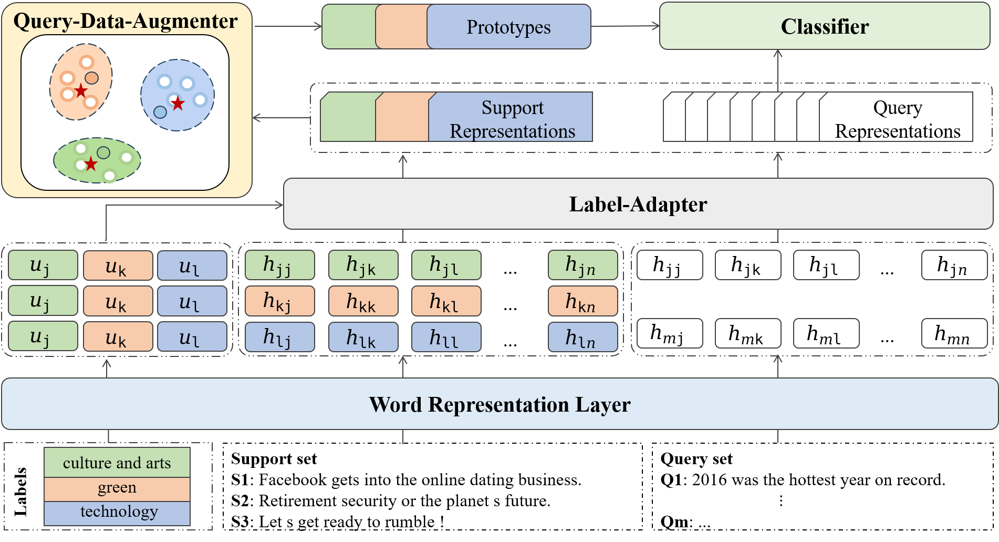

# Improve Meta-learning for Few-Shot Text Classification with All You Can Acquire from the Tasks

The code for LAQDA, published at EMNLP 2024 (findings).
## Abstract
Meta-learning has emerged as a prominent technology for few-shot text classification and has achieved promising performance. However, existing methods often encounter difficulties in drawing accurate class prototypes from support set samples, primarily due to probable large intra-class differences and small inter-class differences within the task. Recent approaches attempt to incorporate external knowledge or pre-trained language models to augment data, but this requires additional resources and thus does not suit many few-shot scenarios. In this paper, we propose a novel solution to address this issue by adequately leveraging the information within the task itself. Specifically, we utilize label information to construct a task-adaptive metric space, thereby adaptively reducing the intra-class differences and magnifying the inter-class differences. We further employ the optimal transport technique to estimate class prototypes with query set samples together, mitigating the problem of inaccurate and ambiguous support set samples caused by large intra-class differences. We conduct extensive experiments on eight benchmark datasets, and our approach shows obvious advantages over state-of-the-art models across all the tasks on all the datasets. 

## Model


## Quick start

### Datasets
The datasets used in this paper are available at ./data

### Installation
```
# Clone the repository
git clone https://github.com/YvoGao/LAQDA
cd LAQDA

# Create a conda environment and install dependencies
conda create -n LAQDA python=3.7
source activate LAQDA
pip install -r requirements.txt
```

### Run
**Noting:** before you start, you should download bert-base-uncased from https://huggingface.co/google-bert/bert-base-uncased, and change the path in the run.sh file to your own file path.
The specific parameters per dataset in the paper are consistent with run.sh.
```
sh run.sh
```

## Citation
```
@inproceedings{liu-etal-2024-improve,
    title = "Improve Meta-learning for Few-Shot Text Classification with All You Can Acquire from the Tasks",
    author = "Liu, Xinyue  and
      Gao, Yunlong  and
      Zong, Linlin  and
      Xu, Bo",
    booktitle = "Findings of the Association for Computational Linguistics: EMNLP 2024",
    month = nov,
    year = "2024",
    doi = "10.18653/v1/2024.findings-emnlp.12",
    pages = "223--235",
}
```